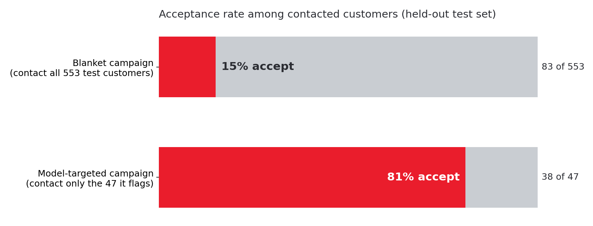
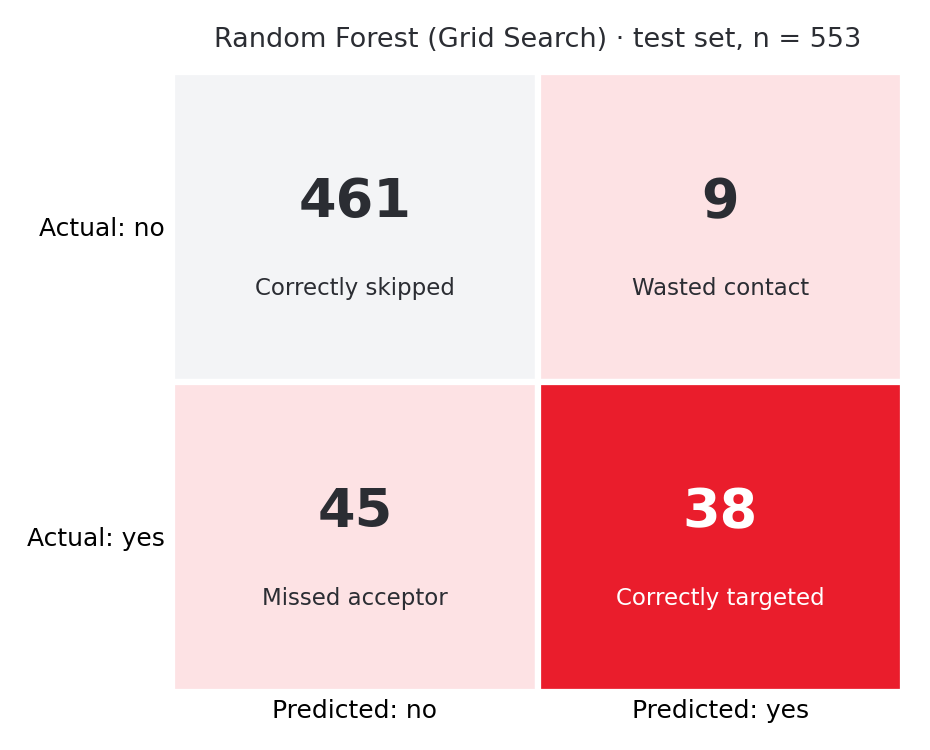
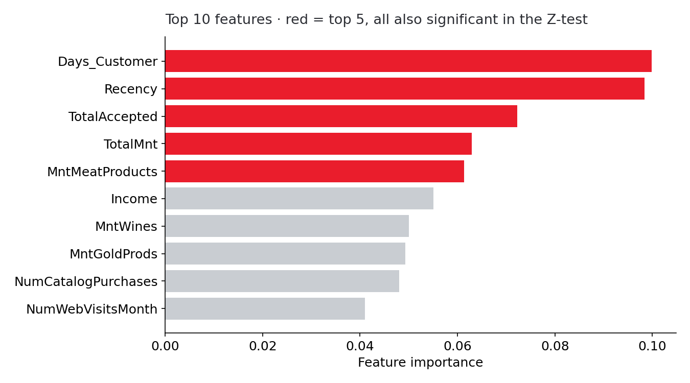

# iFood Campaign Response Prediction

**85% of customers ignore a marketing campaign. This model finds the ones who will, before you hit send.**

On a held-out test set of 553 customers, sending the campaign to everyone reaches 83 acceptors and wastes 470 contacts. The model flags just 47 customers, and **38 of them accept (81%)**.



<p>
  
  
  
  
  
</p>

---

## TL;DR

| | |
|---|---|
| **Problem** | Only 14.9% of customers accept a campaign. Contacting the rest costs money and attention. |
| **Approach** | Hypothesis testing to understand *who* accepts, then 10 ML models to predict *which* customers will. |
| **Result** | Random Forest + Grid Search: **0.809 precision**, **0.895 AUC-ROC**, 0.458 recall on unseen data. |
| **Why it matters** | Statistics and ML independently point to the same customer profile, so the result is explainable, not a black box. |

---

## The business question

A campaign sent to everyone is easy to run and expensive to waste. In this dataset, **only 1 in 7 customers says yes**. The question is not "can we predict the response?" but:

> *If we can only afford to contact a few customers, which ones should they be?*

That framing drove every decision below, starting with the metric.

### Why precision, not accuracy

A model that predicts "no" for everyone is **85% accurate** and completely useless. What matters here is: *of the customers we contact, how many accept?* That is **precision**.

Pushing precision too far, though, means contacting almost nobody. So I set a business constraint: **recall must stay at or above 0.40**, so the campaign still reaches a meaningful share of potential acceptors. Every model was tuned and compared inside that constraint.

---

## Results

| Model | Precision | Recall | F1 | AUC-ROC |
|---|---|---|---|---|
| **Random Forest + Grid Search** (selected) | **0.809** | 0.458 | 0.585 | **0.895** |
| LightGBM (threshold 0.75) | 0.774 | 0.410 | 0.536 | 0.879 |
| XGBoost (threshold 0.85) | 0.760 | 0.422 | 0.542 | 0.871 |
| CatBoost (threshold 0.80) | 0.739 | 0.434 | 0.547 | 0.868 |



**Reading it in business terms:**
- **38** customers correctly targeted, out of 47 contacted.
- Only **9 wasted contacts**, compared with 470 in a blanket campaign.
- **45 acceptors missed.** That is the deliberate trade-off of optimizing for precision. If the cost of contact drops, lowering the decision threshold recovers recall.

---

## How I got there

### 1 · Who accepts? Statistical hypothesis testing

Before training anything, I compared customers who accepted with those who didn't, feature by feature, using a two-sample **Z-test** (α = 0.05).

**22 of 27 features** differ significantly. Customers who accept tend to:
- have **higher income and total spending**;
- have **fewer teenagers at home**;
- have **purchased more recently** (lower recency);
- have **accepted previous campaigns**.

### 2 · Which customers? Ten models in three stages

| Stage | Models |
|---|---|
| Baselines | Logistic Regression, Decision Tree + SMOTE, Random Forest |
| Gradient boosting | LightGBM, XGBoost, CatBoost |
| Hyperparameter tuning | Grid Search, Randomized Search, Bayesian Optimization (×2) |

- **Validation:** stratified 75/25 train/test split and stratified 5-fold cross-validation.
- **Class imbalance:** handled with `class_weight='balanced'`, SMOTE and `scale_pos_weight`, compared rather than assumed.
- **Thresholds:** for the boosting models, the decision threshold was tuned against the precision/recall constraint instead of using the default 0.5.

### 3 · Do statistics and ML agree?



**All 5 of the model's most important features** (`Days_Customer`, `Recency`, `TotalAccepted`, `TotalMnt`, `MntMeatProducts`) were also significant in the Z-test.

Two independent methods, a univariate statistical test and a multivariate model, point to the **same customer profile**: long-standing, recently active, high-spending customers who have said yes before. That makes the model's decisions **explainable to a marketing team**, and every one of these features is something marketing can actually act on.

---

## Limitations and next steps

- **Offline evaluation only.** The real test is an **A/B experiment**: model-targeted vs. random contact, measuring incremental acceptance and campaign ROI.
- **Single snapshot.** Customer behavior drifts. In production, the model would need periodic retraining and performance monitoring.
- **Cost-aware threshold.** With real contact cost and revenue per acceptance, the threshold could be set to maximize expected profit instead of a fixed recall floor.

---

## Dataset

Public iFood data analyst case study: **2,240 customers**, 29 features.

- **Demographics:** age, marital status, number of dependents
- **Spending:** wine, fruits, meat, fish, sweets, gold products
- **Purchase channels:** web, catalog, store visits
- **Engagement:** days as customer, recency, previous campaign responses

**Target:** `Response`, whether the customer accepted the last campaign (14.9% positive).

The raw data is not tracked in this repo. See [`data/README.md`](data/README.md) for the full column dictionary, engineered features and download instructions.

---

## Run it yourself

```bash
git clone https://github.com/PedroIavarone/ifood-data-analysis.git
cd ifood-data-analysis
python -m venv venv
source venv/bin/activate        # Windows: venv\Scripts\activate
pip install -r requirements.txt
```

Download the dataset (see [`data/README.md`](data/README.md)), save it as `data/data.csv`, then:

```bash
jupyter notebook notebooks/ifood_campaign_analysis.ipynb
```

## Project structure

```
ifood-data-analysis/
├── assets/                              # Charts used in this README
├── data/
│   └── README.md                        # Dataset dictionary & download instructions
├── notebooks/
│   └── ifood_campaign_analysis.ipynb    # Full analysis: tests, models, evaluation
├── requirements.txt
├── LICENSE
└── README.md
```

## Tech stack

`pandas` · `numpy` · `matplotlib` · `seaborn` · `statsmodels` · `scikit-learn` · `lightgbm` · `xgboost` · `catboost` · `scikit-optimize` · `imbalanced-learn`

---

## Author

**Pedro Iavarone Custódio** · Building AI that ships to production

[Portfolio](https://pedroiavarone.com) · [LinkedIn](https://www.linkedin.com/in/pedroiavarone) · [GitHub](https://github.com/PedroIavarone)

Questions about this project or open to collaborate? Reach out on [LinkedIn](https://www.linkedin.com/in/pedroiavarone) or through [pedroiavarone.com](https://pedroiavarone.com).
